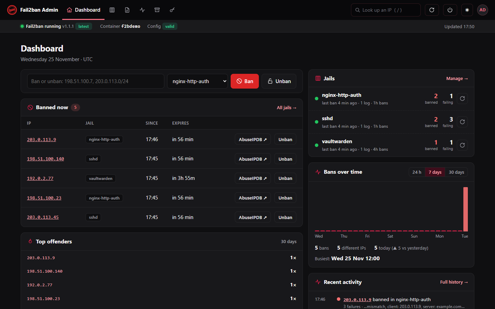
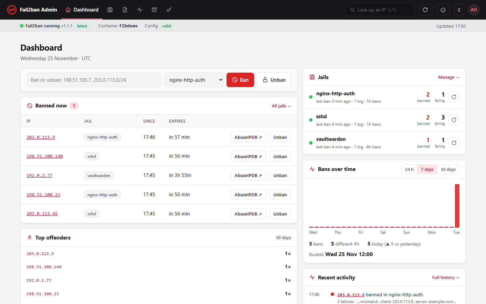
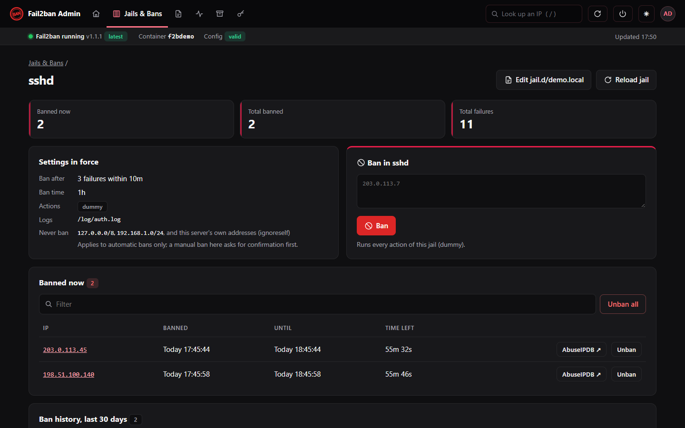
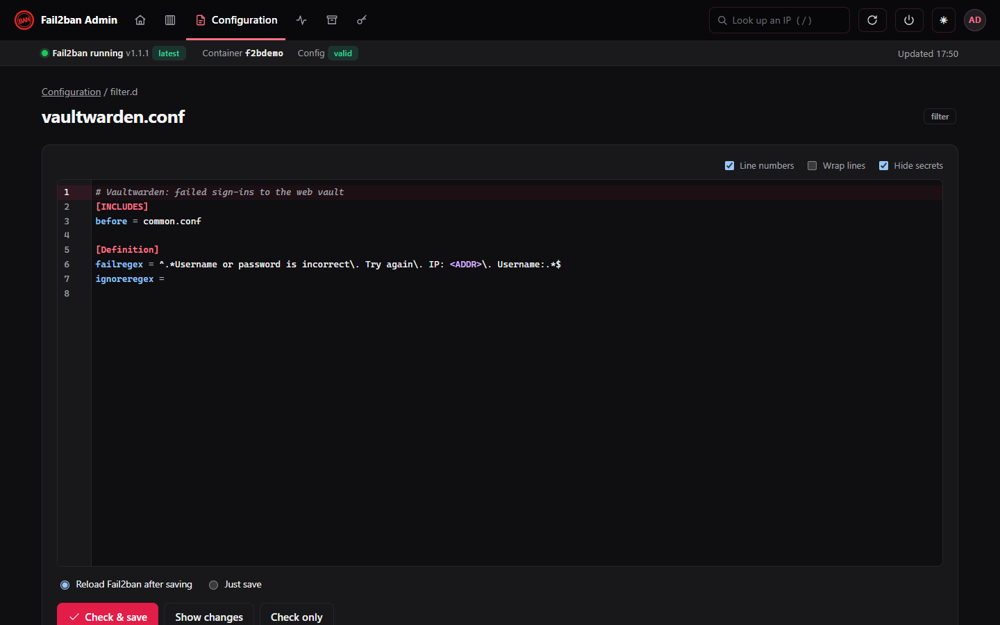
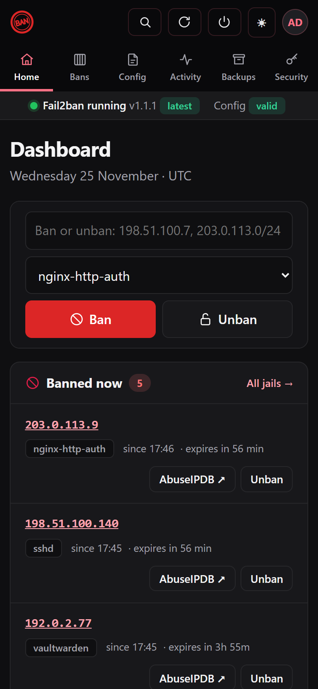

# Screenshots

From a demo setup: the addresses are from the documentation ranges reserved by RFC 5737, and nothing was really
blocked. [Back to the main page](../../README.md)

## Dashboard

Ban box, banned IPs with their AbuseIPDB link, jails, bans over time and recent activity.

## A jail

The settings in force (after all includes and defaults), a ban form, and the IPs banned right now.

## Editor

Editing a filter, with syntax highlighting, completion and validation by Fail2ban's own configuration reader.

## Phone

